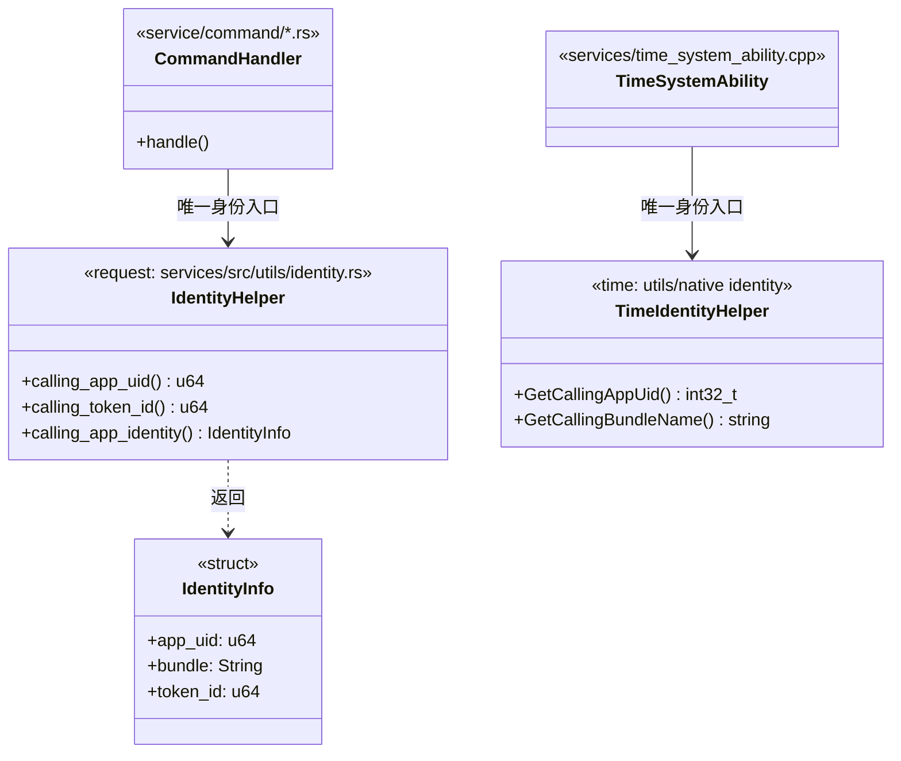

# 架构设计

> 本变更为内部身份标识整改：对外接口签名与运行时行为基线不变，整改面 = 身份获取收口 + 逐使用点语义注释 + 切换点落地（平台 appid 接口已提供并完成单点切换）。

## 设计元数据

| 字段 | 内容 |
|------|------|
| Design ID | DESIGN-UID-APPID-RECTIFY-01 |
| 关联需求 | `proposal.md`（Approved 2026-09-14） |
| 关联 Epic | 无 |
| 目标 Feature | FEAT-UID-APPID-RECTIFY |
| 复杂度 | 标准 |
| 目标版本 | OpenHarmony-7.1-Release |
| Owner | TBD（待需求方指定） |
| 状态 | Approved（2026-09-14 需求方批准） |

## 需求基线

| 项 | 补充说明（如需） |
|----|------------------|
| Q-4 口径 | 内部替换、对外接口签名不变；无 API 变更项 |
| Q-5 口径 | 语义导向逐项甄别：应用身份类 → 已切换 appid 语义（经辅助层 calling_app_uid）；进程/系统级 → 保留 uid + 注释理由 |
| Q-6 口径 | DB 字段不改；代码注释提示字段语义 |
| 接口状态 | **平台 appid 接口已提供**（communication_ipc `GetCallingAppUid` / Rust `calling_app_uid`，@since 26.1.0，当前为 `GetCallingUid` 透传）：辅助层已单点切换为 appid 语义，行为零变化 |

## 上下文和现状

### 涉及仓和模块

| 仓库 | 补充架构说明 |
|------|-------------|
| request_request（Rust 服务 + C++/NAPI/ANI/FFI 框架层） | 下载 SA 主体在 `services/src`（Rust），IPC 命令入口在 `services/src/service/command/`；uid 获取经辅助层 `services/src/utils/identity.rs::calling_app_uid()`（平台 `GetCallingAppUid`）；bundle 获取经 `utils/mod.rs::query_calling_bundle()`（token→bundle FFI）。C++ 侧残留点：`frameworks/native/request/runcount_notify_stub.cpp`、`frameworks/js/napi/cache_download/preload_module.cpp`、`frameworks/ets/ani/.../permission_verification.cpp` |
| time_time_service（C++ SA 3702） | 服务主体在 `services/`；权限判定已 token 化（`services/time_permission.cpp`）；uid 获取经辅助层 `utils/native` identity 工具（`GetCallingAppUid`，平台 appid 接口）；token→bundle 已有 `TimeFileUtils::GetBundleNameByTokenID` |

### 代码事实基线

| 代码引用（文件:行/符号） | 已验证事实 | 关联架构规则 | 对本设计的约束 | 验证来源/可信度 |
|-------------------------|------------|--------------|----------------|-----------------|
| `services/src/task/config.rs:686 / Config::deserialize` | 任务构造时经辅助层 `calling_app_identity()` 同时采集 app_uid/bundle/token_id，且校验 client 伪造的 bundle_type 与 token 派生值一致 | OH-ARCH-IPC-SAF | 归属键已有 bundle/token 同采事实，辅助层必须复用这三者，不得新增旁路获取 | 源码，高 |
| `services/src/manage/query.rs:114-158 / Query::show,touch` | 归属校验为 `info.uid()==uid` 且 token 双因子（touch 含 token 比对） | OH-ARCH-IPC-SAF | 归属判定行为不得变；注释标注"语义=应用身份"（切换已落地） | 源码，高 |
| `services/src/service/command/notification_bar.rs:338 / disable_task_notification_inner` | 越权判定 `task_uid != calling_uid` 即拒绝 | OH-ARCH-IPC-SAF | 判定逻辑不变；uid 获取改经辅助层 | 源码，高 |
| `services/src/manage/app_state.rs:112-211 / app_state_change_callback,process_died_callback` | 前后台/进程死亡/卸载回调均以 uid 为键通知（hiviewx 上报 uid+pid+bundle_name） | OH-ARCH-LAYERING | 回调入参 uid 为平台传入，属进程级语义 → 保留 uid + 注释 | 源码，高 |
| `services/src/task/client.rs:211 / DomainInterceptor::new` | URL 域名策略的 app_id 实为 bundle 名（`config.bundle`） | OH-ARCH-LAYERING | 已有"bundle 当 app_id"先例；本设计注释中须区分"bundle≠PC 场景新 appid 语义" | 源码，高 |
| `frameworks/native/request/src/runcount_notify_stub.cpp:79 / OnRemoteRequest` | C++ stub 侧 `IPCSkeleton::GetCallingUid()` 后直接做权限拒绝日志 | OH-ARCH-ERROR-LOG | 保留 uid + 注释；日志格式不变 | 源码，高 |
| `frameworks/ets/ani/cache_download/src/cxx/permission_verification.cpp:27-43` | 权限校验已基于 `GetCallingFullTokenID`+`AccessTokenKit::VerifyAccessToken` | OH-ARCH-IPC-SAF | 已 token 化，无需改动；纳入注释确认清单 | 源码，高 |
| `services/time_system_ability.cpp:479 / ProxyTimer(OnRemoteRequest→CreateTimer 入口)` | 定时器创建以 `GetCallingAppUid()` 归属（当前透传），uid 入 TimerInfo→DB→hisysevent | OH-ARCH-IPC-SAF | 归属链行为不变；注释标注应用身份语义（切换已落地） | 源码，高 |
| `services/time_system_ability.cpp:678-681 / Dump` | `uid > maxUid(10000)` 判定系统调用方（Linux uid 语义假设） | OH-ARCH-IPC-SAF | 系统/进程级语义 → 保留 uid + 注释说明假设来源 | 源码，高 |
| `services/time_permission.cpp:69-96 / CheckCallingPermission,CheckSystemUidCallingPermission` | 权限校验走 `GetCallingTokenID`+`AccessTokenKit`/`TokenIdKit::IsSystemAppByFullTokenID`，无 uid 判定 | OH-ARCH-IPC-SAF | 维持 token 化，禁止回退为 uid 判定（spec R-5） | 源码，高 |
| `services/timer/src/timer_manager.cpp:216-253 / AddTimerName,DeleteTimerName` | timerNameMap_ 以 uid 为一级 key | OH-ARCH-LAYERING | 内部数据结构本版本不改（DB 字段同理），注释标注语义 | 源码，高 |
| `utils/native/src/time_file_utils.cpp:35 / GetBundleNameByTokenID` | 已有 token→bundle 工具 | OH-ARCH-LAYERING | time 仓辅助层复用该既有工具模式，不新造轮子 | 源码，高 |

### 调用链层级分析

| 层 | 模块 | 职责 | 修改类型 |
|----|------|------|----------|
| 应用层 | 三方应用（@ohos.request / @ohos.systemDateTime 等） | 发起上传下载/定时器调用 | 无修改 |
| 框架层（NAPI/ANI/CJ/FFI） | request: frameworks/js、ets、cj；time: framework/js（napi/ani/taihe） | API 封装与参数转发 | 修改（仅注释/确认清单：preload_module.cpp、permission_verification.cpp、runcount_notify_stub.cpp） |
| 服务层（SA） | request: services/src（Rust）；time: services/（C++） | 身份获取收口、归属判定、打点归因 | 修改（辅助层 + 语义注释） |
| 公共工具层 | request: services/src/utils；time: utils/native | 身份获取辅助层落点 | 修改（新增统一入口） |
| 内核/驱动 | — | 不涉及 | 无 |

**检查项：**
- [x] 调用链每一层都已覆盖（应用→框架→服务→工具；无内核层变更）
- [x] 每层职责边界清晰：身份获取只许在工具层辅助函数内，业务层不得直取
- [x] 每层修改类型明确

### 适用架构规则

| Rule ID | 适用原因 | 设计结论 | 验证方式 |
|---------|----------|----------|----------|
| OH-ARCH-LAYERING | 工具层新增辅助层，服务/框架层调用 | 仅允许服务层与框架层经辅助层获取身份；禁止跨层直调 IPCSkeleton | 代码评审 + grep（VM-7） |
| OH-ARCH-SUBSYSTEM | 双仓整改，不新增跨子系统调用 | 不新增对 ability_runtime/bundle_manager 的运行时依赖；appid 接口经既有 ipc 依赖获取（GetCallingAppUid），无新增依赖 | 依赖检查（BUILD.gn 无变更） |
| OH-ARCH-IPC-SAF | 身份取自 Binder IPC 上下文 | 身份获取必须来自 IPC 上下文（token/uid），不得信任客户端自报字段；既有 token 校验不得削弱 | 单测回归（VM-1/VM-5） |
| OH-ARCH-API-LEVEL | 无 API 变更（Q-4） | N/A | — |
| OH-ARCH-COMPONENT-BUILD | 无新增 target | BUILD.gn/bundle.json 不变；辅助层为源文件级新增 | 构建验证 |
| OH-ARCH-ERROR-LOG | 日志含 uid 明文 | 日志格式与打点字段不变（含 uid 明文属审计需要，既有实现如此） | 单测回归（VM-4） |

### 既有模式复用

| 模式 | 参考代码（文件:行/符号） | 适用架构规则 | 必须复用的约定 | 本设计的复用方式 | 偏差及理由 | 关联 Task |
|------|-------------------------|--------------|----------------|------------------|------------|-----------|
| token→bundle 工具模式 | `services/src/utils/mod.rs:366 / query_calling_bundle` | OH-ARCH-LAYERING | `#[cfg(feature="oh")]` 门控、pub(crate) 可见性、FFI 桥接 | 扩展：request 辅助层以此函数为 bundle 侧来源 | 无 | TASK-1 |
| token→bundle 工具模式（C++） | `utils/native/src/time_file_utils.cpp:35 / GetBundleNameByTokenID` | OH-ARCH-LAYERING | 静态工具类、tokenID 入参 | 扩展：time 辅助层复用该函数，不新造 | 无 | TASK-3 |
| IPC 身份封装模式 | `services/src/utils/mod.rs / ipc::Skeleton` 封装使用方（config.rs:686 等） | OH-ARCH-LAYERING | 经封装取身份而非裸调 | 扩展：uid 获取迁入辅助层，Skeleton 直取仅辅助层内部保留 | 无 | TASK-1 / TASK-3 |
| 权限 token 化模式 | `services/time_permission.cpp:69 / CheckCallingPermission` | OH-ARCH-IPC-SAF | VerifyAccessToken + GetCallingTokenID | 直接复用：不改动 | 无 | TASK-4 |

## 不涉及项承接

| 维度 | 设计结论 |
|------|----------|
| 安全与权限（proposal 标记"涉及"） | 维持 token 化权限判定（R-5）；归属判定语义注释；详见"安全基础检查" |
| IPC/跨进程（proposal 标记"涉及"） | 身份获取仅自 IPC 上下文；辅助层单点化；对外 IPC 接口签名与校验行为不变 |
| 兼容性（proposal 标记"涉及"） | DB 字段/打点字段/接口签名全部不变；代码注释承接字段语义说明 |

## 关键设计决策

| 决策 ID | 问题 | 推荐方案 | 探索过的替代方案 | 取舍理由 | 影响 |
|---------|------|----------|-----------------|------|------|
| ADR-1 | 调用方身份获取如何收口？ | **每仓一个统一辅助层**（request: `services/src/utils/identity.rs`；time: `utils/native` 新增 identity 工具），业务代码一律经辅助层；辅助层已切换到平台 appid 接口 `GetCallingAppUid` / `calling_app_uid`（@since 26.1.0，当前为 `GetCallingUid` 透传，行为零变化） | ① 仅逐点加注释不收口（放弃：切换时需全仓再改一遍，违背 US-3）；② 全量替换为 bundle 名（放弃：bundle 不区分同 bundle 多用户/非 PC appid 语义，且改变归属行为）；③ 等接口提供后再改（放弃：需求方要求本版本完成说明与预留） | 收口成本一次到位，切换点唯一；行为零变化 | spec R-6 / AC-3.1 / AC-3.2 |
| ADR-2 | request 仓归属判定（uid）本版本如何处理？ | **归属判定切至 appid 语义**：经辅助层 `calling_app_uid()`（平台 `GetCallingAppUid`）获取，当前为透传、行为与 uid 判定一致 | ① 改用 (bundle, uid) 组合键（放弃：改变边界行为，AC-1.1 回归风险）；② 改用 bundle 键（放弃：同理由，且多用户场景错误） | Q-4 口径"内部替换、签名不变"；接口落地后经辅助层单点切换（INV-1） | spec R-1 / R-2 |
| ADR-3 | time 仓 Dump 的 `uid > 10000` 系统判定如何处理？ | **保留 uid 判定 + 注释**（语义=系统/进程级判定，Linux 假设来源注明） | ① 改 token type 判定（放弃：改变 Dump 权限行为，超出基线）；② 删除判定（放弃：安全风险） | 进程/系统级语义按 Q-5 应保留 uid | spec R-3 |
| ADR-4 | DB 字段（任务库/定时器库 uid 列）如何处理？ | **不改字段，写入处加注释**说明"该字段语义=调用方应用身份（app uid）；PC 场景迁移另行评估" | ① 新增 appid 列（放弃：Q-6 明确不改）；② 迁移存量（放弃：同上） | 基线 Q-6 已定 | spec R-4；兼容性声明 |

## 设计骨架

### 骨架范围

| 骨架项 | 目标 | 不包含 | 验证方式 |
|--------|------|--------|----------|
| 接口骨架 | 两仓身份辅助层的函数签名（返回 uid 的单一入口） | 业务逻辑、appid 实现 | 编译通过 + grep 唯一性 |
| 模块骨架 | 辅助层源文件落点（request: utils/identity.rs；time: utils/native/identity） | 目录重构 | 构建通过 |
| 测试骨架 | 现有单测全量保留 | 新行为用例（本版无行为变化） | 回归通过 |

### 骨架 Spec 拆分

| Task ID | 目标 | 受影响文件 | AC |
|---------|------|------------|-----|
| TASK-SKELETON-1 | 建立两仓身份辅助层骨架（空壳返回现有 uid 获取） | `request_request/services/src/utils/identity.rs`（New）、`time_time_service/utils/native/src/identity.cpp`（New） | WHEN 编译两仓 THEN 辅助层可调用且行为与直取 uid 一致 |

## 后续 Task 拆分

| Task ID | 目标 | 受影响文件 | 依赖 |
|---------|------|------------|------|
| TASK-1 | request 仓：身份辅助层实现 + 业务改点迁移 + 语义注释 | `services/src/utils/identity.rs`、`service/command/*.rs`、`manage/*.rs`、`task/*.rs`、C++ 残留点 | design.md + spec.md Approved |
| TASK-2 | request 仓：逐使用点语义注释审计（含 DB 写入处、framework 层确认清单） | 同 TASK-1 范围 + `frameworks/js/napi/cache_download/preload_module.cpp` 等 | TASK-1 |
| TASK-3 | time 仓：身份辅助层实现 + GetCallingUid 改点迁移 + Dump/注释 | `utils/native/*`、`services/time_system_ability.cpp`、`services/timer/src/timer_manager.cpp` | design.md + spec.md Approved |
| TASK-4 | time 仓：打点归因/DB 写入处语义注释 + 权限路径确认（维持 token 化） | `services/dfx/src/time_sysevent.cpp`、`services/time/src/time_zone_info.cpp`、`services/time_permission.cpp` | TASK-3 |
| TASK-5 | 双仓回归验证与证据（编译 + 现有单测全绿 + grep 收口检查） | 两仓 test/ | TASK-2、TASK-4 |

## API 签名、Kit 与权限

### 新增 API

无（Q-4：对外签名不变；辅助层为 InnerAPI 级内部函数，不进 d.ts）。

### 变更/废弃 API

无。

## 构建系统影响

### BUILD.gn 变更

```
无 BUILD.gn 变更：辅助层加入既有 target 源文件清单（request: services BUILD.gn 的 utils 源列表；
time: utils/native/BUILD.gn 源列表）。如构建系统要求显式登记，execution-plan 按"生成文件不得手工合入"
规则核对源列表维护方式后执行。
```

### bundle.json 变更

无（无部件/依赖增删）。

---

## 可选设计扩展

### 类图



| 类型/接口 | 现有代码引用或 New | 关系 | 关键职责/签名 | 关联 ADR | 关联 Task |
|-----------|--------------------|------|---------------|----------|-----------|
| `IdentityHelper` | New（参照 `services/src/utils/mod.rs:366` 模式） | 被服务层组合持有/调用 | `calling_app_uid() -> u64`；`calling_token_id() -> u64`；`calling_app_identity() -> IdentityInfo{app_uid,bundle,token_id}` | ADR-1 / ADR-2 | TASK-1 |
| `IdentityInfo` | New | 值对象，由 IdentityHelper 返回 | 只读结构：app_uid/bundle/token_id | ADR-1 | TASK-1 |
| `TimeIdentityHelper` | New（参照 `utils/native/src/time_file_utils.cpp:35` 模式） | 被 TimeSystemAbility/TimerManager 调用 | `GetCallingAppUid() -> int32_t`；`GetCallingBundleName() -> std::string` | ADR-1 / ADR-3 | TASK-3 |

### 数据流/控制流

| 步骤 | 调用方 | 被调用方 | 数据/接口 | 说明 |
|------|--------|----------|-----------|------|
| 1 | 应用 | 服务 SA（IPC） | create/timer 请求 | 与基线一致 |
| 2 | 命令入口 | IdentityHelper / TimeIdentityHelper | app uid（appid） | 本设计收口点；唯一变化是获取路径 |
| 3 | 归属/打点逻辑 | 既有模块 | uid 语义不变 | 行为零变化，仅注释 |

### 状态归属与不变量

#### 状态归属

| State ID | 状态/资源 | 唯一 Owner | 存储/Key/Index | 创建与初始化 | 读取/更新方 | 清理/恢复/回滚触发 | 并发模型 | 代码事实/规则来源 |
|----------|-----------|------------|-------------------|------------|-------------|--------------------|----------|-------------------|
| STATE-1 | 任务归属键（uid，本版本不变） | request 下载 SA（TaskConfig.common_data.uid） | 任务内存表 + 任务库 uid 列 | 任务构造时由辅助层写入（`config.rs:686` 现状迁移） | query/search/notification 归属校验只读 | 任务删除/卸载事件清理（app_state.rs:206） | 事件循环单线程 + DB 异步读写 | `services/src/task/config.rs:121` + OH-ARCH-IPC-SAF |
| STATE-2 | 定时器归属键（uid，本版本不变） | time TimeSystemAbility（TimerInfo.uid） | TimerManager 内存表 + 定时器库 uid 列 + hisysevent 字段 | CreateTimer 时由辅助层写入（`time_system_ability.cpp:479` 现状迁移） | 打点/恢复/Dump 只读 | 定时器销毁清理 | SA 主线程 + 定时器线程 | `services/time_system_ability.cpp:479` + OH-ARCH-IPC-SAF |
| STATE-3 | 身份获取入口唯一性 | 各仓 utils 辅助层 | 源码结构（非运行时状态） | 本变更建立 | 服务/框架层只读调用 | 重构变更需经 code review（VM-7） | 静态约束 | ADR-1 + OH-ARCH-LAYERING |

#### 不变量追溯

| Invariant ID | State ID / 范围 | 必须始终成立的约束 | 关联 AC | 关联 Task | 验证方式与通过标准 | 违反时处理 |
|--------------|------------------|--------------------|---------|-----------|--------------------|------------|
| INV-1 | STATE-3 | 业务代码（服务/框架层）中调用方身份获取仅经 IdentityHelper/TimeIdentityHelper，无 `calling_app_uid`/`GetCallingAppUid` 散落直取（测试代码除外） | AC-3.1 | TASK-1 / TASK-3 | grep 检查（VM-7）：`grep 'calling_app_uid\|GetCallingAppUid' services/ frameworks/ --exclude-dir=test` 仅辅助层文件命中；通过标准 = 0 处散落 | 迁移到辅助层后复测 |
| INV-2 | STATE-1 / STATE-2 | 本版本任何对外可观察行为（归属判定结果、打点字段、DB 内容、错误码）与变更前逐点一致 | AC-1.1 / AC-2.1 / AC-2.2 | TASK-5 | 两仓现有单测全绿（VM-1/VM-4/VM-5）+ 关键路径抽查；通过标准 = 全绿且无行为差异 | 停止交付，回查改点 |
| INV-3 | STATE-1 / STATE-2 注释面 | 每个保留 uid 的使用点注释含语义结论（应用身份→待切换 / 进程系统级→保留理由） | AC-1.2 / AC-1.3 / AC-2.4 | TASK-2 / TASK-4 | 代码评审（VM-2/VM-3/VM-6）+ grep 抽查注释标记；通过标准 = 清单 100% 覆盖 | 补注释后复评 |

### 线程与并发模型

| 操作 | State ID / 竞争对象 | 发起线程 | 回调线程 | 跨进程边界 | 同步/所有权机制 | 锁顺序/重入约束 | 关联不变量 |
|------|---------------------|----------|----------|------------|----------------|----------------|------------|
| 身份获取 | STATE-3 | Binder 调用线程 | 同线程返回 | 是（IPC 上下文读取） | IPC 上下文 TLS，无锁 | 无状态、可重入 | INV-1 |
| 任务归属读写 | STATE-1 | 事件循环 | 事件循环 | 否 | 事件循环单线程封闭 | 保持既有顺序 | INV-2 |
| 定时器归属读写 | STATE-2 | SA 主线程 | 定时器线程读 | 否 | 既有锁模型不变 | 保持既有顺序 | INV-2 |

**并发场景：** 本变更不引入新并发面；INV-1/INV-2 的维护依赖"不改同步模型"约束，回归由 TASK-5 验证。

### 安全基础检查

> proposal「安全与权限」= 是（单一触发源），按 security-playbook 展开。

#### 信任边界交叉分析

| 边界类型 | 跨越的交互 | 风险 | 约束 |
|---|---|---|---|
| 沙箱内外（应用进程 ↔ 系统服务 SA） | IPC 创建任务/定时器 | 身份伪造导致归属错配 | 身份仅取自 Binder IPC 上下文（token/uid 由内核注入不可伪造）；禁止信任客户端自报字段（现状 config.rs bundle_type 校验即此约束）；本变更不得削弱该边界 |
| 本地/远程 | 无新增网络交互 | — | 无变化 |

#### 基础安全要求

| 检查项 | 结论 | 说明/措施 |
|---|---|---|
| 加密算法 | N/A | 无加密变更 |
| 密钥管理 | N/A | 无密钥变更 |
| 随机数 | N/A | 无变更 |
| 输入验证 | 不变 | 既有 parcel 校验与 bundle_type 防伪校验保持（config.rs:693-705） |
| 错误处理 | 不变 | 错误码与拒绝路径零变化（INV-2） |
| 配置 | 不变 | 无配置变更 |
| 敏感数据处理（传输/存储/日志） | 不变 | 无新增敏感数据；日志/打点 uid 明文沿用既有审计设计（request 仓注释明示 intentional） |

#### 深度威胁分析（如需）

未命中高风险判据：无敏感数据处理、无网络暴露、无认证授权机制变更、无合规项、非关键基础设施。本变更为内部语义标注 + 调用收口，且对外行为零变化。**结论：不产出 threat-model.md**；平台 appid 接口已落地（`GetCallingAppUid` 当前为透传，无新身份派发机制），行为零变化；若后续 appid 语义演进引入新机制，重新评估。

## 风险和开放问题

| 项 | 类型 | 影响 | 处理方式 | Owner |
|----|------|------|----------|-------|
| 平台 appid 接口提供时点 | 外部依赖 | 已解决（2026-11-10） | communication_ipc 提供 `GetCallingAppUid`（@since 26.1.0），辅助层已单点切换（INV-1 保证切换成本）；当前为透传，行为零变化 | 需求方/平台 |
| 双仓 Owner 未指定 | 组织 | 中 | 基线已记 TBD；合入前必须指定 | 需求方 |
| 语义甄别遗漏（某使用点未标注） | 实现 | 中 | TASK-2/TASK-4 审计清单对照 INV-3 兜底 | 实现人 |

## 设计审批

- [x] 需求基线已确认，设计覆盖 P0/P1 AC（AC-1.1~AC-3.2 全部有 R/INV/Task 承接）
- [x] 不涉及项已承接，N/A 和展开项都有结论
- [x] 涉及仓和模块职责清楚
- [x] 调用链层级分析完整，每层覆盖到位
- [x] 涉及既有实现时，代码事实基线使用文件:行/符号引用，且每项事实已转化为设计约束
- [x] 已检索并记录既有模式复用；无现有技术时有检索范围和理由
- [x] 适用架构规则已识别并形成设计结论
- [x] 分层和子系统边界合规
- [x] 命中类/接口关系触发条件时，类图与代码事实、ADR、Task 一致
- [x] 涉及状态/资源/并发时，状态 Owner 唯一，生命周期、恢复和锁/消息模型无冲突
- [x] 每项 `INV-*` 均关联 AC、Task 和可执行验证方式，状态机/资源/并发章节引用一致
- [x] API 变更有签名、权限、错误码和兼容性说明（N/A 承接）
- [x] BUILD.gn/bundle.json 影响明确
- [x] 设计输出和后续 Task 拆分明确
- [x] 关键设计决策有理由和影响说明
- [x] 安全和权限维度已展开安全基础检查；未命中深度威胁分析判据并记录理由

**结论:** 通过（2026-09-14 需求方批准）；实施完成（2026-11-10，两仓辅助层切换 + 语义注释已合入）
